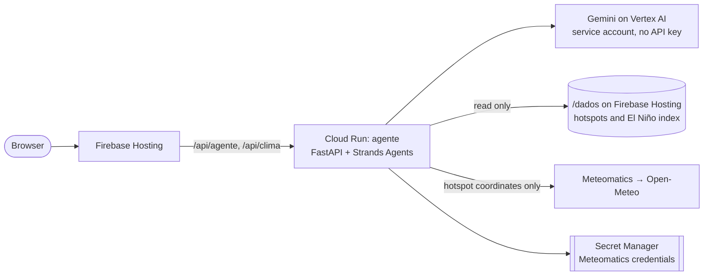
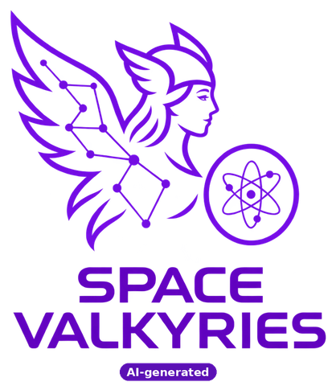

# Cass — the CassAAndra Alert agent

<p align="center">
  
</p>

**Not a forecast. Precision.**

Cass is the chat agent of [CassAAndra Alert](https://github.com/Montezi/cassaandra-alert-frontend). It explains, in English and Portuguese, what the NISAR radar measured on the ground at hotspots sensitive to El Niño: where water rose, where land dried out, where forest burned. It answers only with measured data, always with date and source, and never claims that El Niño caused a change. Built by team **Space Valkyries** for the **NASA Space Apps Challenge 2026**, challenge _Dancing with the SARs_.

[**Open the app →**](https://cassaandra-alert.web.app/app) · [Frontend repository](https://github.com/Montezi/cassaandra-alert-frontend)

[](LICENSE)

> **Sample data.** Until the radar pipeline publishes real results, the hotspot data is an illustrative sample (`metadata.sample: true`). Cass says so in every answer that uses it.

## What it does

|                          |                                                                                                                                                                       |
| ------------------------ | --------------------------------------------------------------------------------------------------------------------------------------------------------------------- |
| **Ask Cass**             | `POST /api/agente` answers a question about a hotspot with short paragraphs, the tools it used, the sources and a note. A streaming variant shows progress live.      |
| **Measured × Hypothesis** | Measured numbers come from tool results, with source and date. A possible cause is a hypothesis with its evidence and strength (weak, moderate or strong), built by code. |
| **Rain forecast**        | `GET /api/clima` returns the next days of rain for a hotspot: Meteomatics, then Open-Meteo, then the last saved snapshot, always with the source and update time.     |
| **WhatsApp alert**       | Cass drafts an alert message for civil defense teams. A forecast older than 3 days never triggers an alert.                                                           |
| **Bilingual**            | Every answer comes in the language the app asks for, `pt` or `en`.                                                                                                    |

## How it works

<p align="center">
  
</p>



1. **Receive.** FastAPI validates the request (question up to 500 characters, a known `hotspot_id`, body up to 2 KB) and applies rate limits. It only receives the request and calls the agent.
2. **Look up.** The Strands agent calls read-only tools that fetch the static files the pipeline published in `/dados`.
3. **Check.** Interventions, steering and a final verification make sure every number in the answer came from a tool result.
4. **Answer.** The agent produces a structured answer, and `cass/contrato.py` converts it to the public format in [`docs/api-contract.md`](docs/api-contract.md).

## Tools

All tools are read-only. They build the URL from `DADOS_BASE` and an `id` checked against `hotspots.geojson`. The forecast also reads `api.meteomatics.com` and `api.open-meteo.com`, only with a hotspot's own coordinates. Errors come back as data (`{"erro": ..., "validos": [...]}`) so Gemini can correct itself.

| Tool                | What it returns                                     | Status                       |
| ------------------- | --------------------------------------------------- | ---------------------------- |
| `listar_hotspots`   | The six hotspots and their ids                      | Active                       |
| `consultar_hotspot` | Class, affected area, dates and sources of a hotspot | Active                       |
| `contexto_enso`     | The El Niño index (NOAA CPC) as regional context    | Active                       |
| `previsao_tempo`    | Rain forecast with source and update time           | Active                       |
| `rascunhar_alerta`  | Draft of a WhatsApp alert                           | Active                       |
| `explicar_classe`   | Why a cell got its class                            | Waiting for pipeline statistics |
| `hipotese`          | Hypothesis with evidence and strength               | Waiting for pipeline statistics |
| `exposicao`         | People and places in the affected area              | Waiting for pipeline statistics |

## Harness and guardrails

<p align="center">
  
</p>

Cass uses the [Strands Agents](https://strandsagents.com) harness, with each piece doing one job:

| Piece             | Role                         | In Cass                                                                                                                       |
| ----------------- | ---------------------------- | ----------------------------------------------------------------------------------------------------------------------------- |
| **Skills**        | Knowledge on demand          | `explicar-radar`, `medido-vs-hipotese`, `contexto-el-nino`, `alerta-whatsapp` in [`skills/`](skills)                          |
| **Interventions** | Hard rules (Deny, Transform) | `PortaoDeFerramentas` allows only Cass's tools, at most six calls per question. `LimpaDados` trims free text in tool results and keeps numbers and sources intact. |
| **Steering**      | Course correction (Guide)    | `SteeringCass` asks the user which hotspot they mean instead of guessing, and asks for one rewrite when an answer claims El Niño caused a change. |
| **Hooks**         | Observe only                 | `ProgressoERegistro` logs tool names and times and feeds the streaming progress events.                                       |
| **Decider**       | Decision model (optional)    | Called only through `decider_sim()`, which returns a safe default when it is off, slow or down.                               |

Plus input checks (scope and prompt injection), a token and turn budget per question, and an output check that compares every number in the answer with the tool results.

**About the Strands Decider.** It is integrated but **off** in production (`DECIDER_ATIVO=false`). In our pilot it needed about 7.8 GiB of memory and missed the 1.5 s deadline in 35 of 36 calls, so it did not fit our latency and cost budget. Turning it on is a build flag and an environment variable. Details in [`docs/avaliacao-decider.md`](docs/avaliacao-decider.md).

## Security

- **No API keys for Gemini.** Locally, Application Default Credentials. On Cloud Run, the `cass-agente` service account with `roles/aiplatform.user`.
- **Meteomatics credentials in Secret Manager**, delivered to the service with `--update-secrets`. `.env` never goes to git.
- **No dangerous tools.** Cass has no file access, shell, web search, disk writes or network access outside the destinations above.
- **`/api/clima` accepts only the coordinates of a known hotspot**, so nobody can use our Meteomatics account for other places.
- **Limits** on request size, question length, concurrent requests, requests per minute and per IP, and response size from external sources (1 MiB, no redirects).
- Details in [`docs/seguranca.md`](docs/seguranca.md) and [`docs/guardrails.md`](docs/guardrails.md).

## Tech stack

- Python 3.12, [Strands Agents](https://strandsagents.com) 1.65 with `GeminiModel`
- Gemini `gemini-3.8-flash` on Vertex AI (location `global`, low thinking level)
- [FastAPI](https://fastapi.tiangolo.com), [Pydantic](https://docs.pydantic.dev) and [httpx](https://www.python-httpx.org)
- Google Cloud Run, Secret Manager and Cloud Build

## Getting started

Requires **Python 3.12** and the [Google Cloud CLI](https://cloud.google.com/sdk/docs/install).

```bash
python3.12 -m venv .venv
source .venv/bin/activate
pip install -r requirements-dev.txt
cp .env.example .env              # fill in GOOGLE_CLOUD_PROJECT
gcloud auth application-default login
uvicorn cass.main:app --reload --port 8080 --env-file .env
```

With the frontend running (`npm run dev`), Vite forwards `/api/*` to `http://localhost:8080`.

```bash
curl -fsS http://localhost:8080/health
curl -fsS "http://localhost:8080/api/clima?hotspot=guaiba-rs&lat=-30.0&lon=-51.2"
curl -fsS -X POST http://localhost:8080/api/agente \
  -H 'Content-Type: application/json' \
  --data '{"question":"What changed at Guaíba?","hotspot_id":"guaiba-rs","language":"en"}'
```

### Configuration

| Variable                                     | What it is                                                                 |
| -------------------------------------------- | -------------------------------------------------------------------------- |
| `GOOGLE_CLOUD_PROJECT`                       | Google Cloud project for Vertex AI                                         |
| `GOOGLE_CLOUD_LOCATION`                      | Gemini location (`global`)                                                 |
| `GEMINI_MODEL`                               | Model id (`gemini-3.8-flash`)                                              |
| `APP_ORIGIN`                                 | Frontend origin, for CORS                                                  |
| `DADOS_BASE`                                 | Where the pipeline data lives (`${APP_ORIGIN}/dados`)                      |
| `METEOMATICS_USER`, `METEOMATICS_PASSWORD`   | Optional. Without them, the forecast starts at Open-Meteo, which needs no key |
| `DECIDER_ATIVO`, `DECIDER_URL`               | Strands Decider switch and local address (off by default)                  |

## Tests

```bash
pytest -q            # 825 tests, no network and no Gemini calls
pytest -q -m gemini  # tests that call Gemini for real
```

Every change comes with a test in [`tests/`](tests). The suite covers the contract, tools, guardrails, steering, hooks, skills, the forecast chain and the security limits.

## Deployment

One Cloud Run service, `agente`, in `us-central1`, serves both `/api/agente` and `/api/clima`. Firebase Hosting rewrites send the app's relative paths to it, so the browser needs no CORS and no key.

```bash
gcloud run deploy agente --source . --region us-central1 \
  --service-account cass-agente@PROJECT_ID.iam.gserviceaccount.com \
  --memory=2Gi --cpu=1 --allow-unauthenticated \
  --update-secrets=METEOMATICS_USER=meteomatics-user:latest,METEOMATICS_PASSWORD=meteomatics-password:latest \
  --set-env-vars=...
```

The full step-by-step, with the exact flags, rollback and costs, is in [`docs/deploy.md`](docs/deploy.md).

## Project structure

```
cass/
  main.py          FastAPI: /health, /api/agente, /api/agente/stream, /api/clima
  agente.py        builds the Strands Agent
  ferramentas.py   the tools (@tool) and the forecast chain
  guardrails.py    decider_sim, PortaoDeFerramentas, LimpaDados, input checks
  steering.py      SteeringCass
  hooks.py         ProgressoERegistro
  verificacao.py   checks every number in the answer against the tool results
  contrato.py      internal answer -> public API format
  modelos.py       Pydantic models for the data and API contracts
  limites.py, seguranca_http.py   rate limits and HTTP safety
skills/            Cass skills, one folder each
tests/             pytest suite and fixtures
evaluation/        Strands Decider evaluation sets
docs/              contracts, deploy, guardrails, security, development plan
```

## Documentation

- [`docs/api-contract.md`](docs/api-contract.md): requests and answers of `/api/agente` and `/api/clima`
- [`docs/data-contract.md`](docs/data-contract.md): the files the pipeline publishes in `/dados`
- [`docs/fluxo-de-dados.md`](docs/fluxo-de-dados.md): how data flows from the pipeline to Cass
- [`docs/guardrails.md`](docs/guardrails.md) and [`docs/seguranca.md`](docs/seguranca.md): guardrails and security review
- [`docs/deploy.md`](docs/deploy.md): Cloud Run deployment
- [`docs/plano-de-desenvolvimento.md`](docs/plano-de-desenvolvimento.md): the step-by-step plan we followed

Most internal docs are in Portuguese.

## Team

<p align="center">
  
  &nbsp;&nbsp;&nbsp;
  
</p>

Made by **Space Valkyries** (Ana, Aline and Mirian) for the NASA Space Apps Challenge 2026.

**AI-generated images:** Cass, the CassAAndra mascot, and the Space Valkyries logo are AI-generated. Every image of them in this repository carries an "AI-generated" label.

This is a team project for the NASA Space Apps Challenge. It is not affiliated with or endorsed by NASA.

## License

[MIT](LICENSE). Data sources keep their own licenses and terms.
